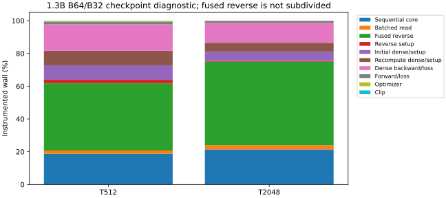
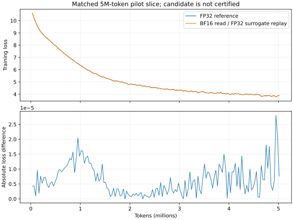

# X40 part 10 — corrected decomposition and unpromoted BF16 evidence

**Task acceptance: FAILED / incomplete. No production speedup or BF16 adoption
is accepted.** Detailed [decision receipt](receipts/part10/decision.md) and
[machine-readable gate](receipts/part10/gate.json) preserve the remaining gaps.

At the 1.3B shape, fixed B64/B32 checkpoint diagnostics measure 12.000 / 72.378 s
at T512/T2048. Fused reverse accounts for 4.927 / 36.914 s; sequential forward
core (initial plus recompute) 2.247 / 15.468 s; batched read 0.237 / 1.855 s;
reverse setup/teardown 0.262 / 0.322 s. Reverse read-math and sparse/event adjoints
remain fused; no invented wall split is reported.

T512: score/softmax recomputation is 4.07% of instrumented reverse CTA cycles (cycle-weighted device estimate 197.45 ms); read adjoints are 70.88%. T2048: score/softmax recomputation is 11.79% of instrumented reverse CTA cycles (cycle-weighted device estimate 4363.98 ms); read adjoints are 64.53%. These occupancy-weighted cycle diagnostics pass
fresh pressure-inclusive parity but are not additive wall phases. Read adjoints,
rather than repeated score/softmax alone, dominate the instrumented reverse.

The current native read uses
FP32 vector arithmetic, not GEMM. BF16 forward read alone cannot explain 1x.

Both arms processed **5,013,504 tokens** in 153 updates, with identical token/target SHA256. Maximum absolute loss difference: **2.8014183e-05**; mean: **6.300172e-06**; final FP32 / candidate losses: **3.89899993 / 3.8989923** (difference 7.62939453e-06).

The read-only BF16 MMA experiment leaves production store kernels untouched,
but retains FP32 surrogate replay and fails CPU/native bitwise read parity.
It stays isolated from production. B1 isolated throughput ranges from small
gains to slowdowns on deep T2048 lanes; shared head shapes are the same at 22M
and 1.3B. Read-only caching is insufficient for reverse; two deep-lane probability
caches cost 1.5 / 12.9375 GiB at T512/T2048 for B32 × 24 blocks. The query-adjoint
component cache passes bytewise checks; no full-step caching speedup is claimed.

| T | Pure tok/s | BF16 transformer tok/s | Pure step / control step |
|---|---:|---:|---:|
| 512 | 2761.32 | 6110.27 | 2.2128 |
| 2048 | 1808.83 | 5801.37 | 3.2073 |

Fresh unchanged B128 bare/fused-pool pilot: **55,429.54 tok/s**, 3 warmups and 20 full updates. 100k gate: **FAILED**. Qualification inherits the unchanged part8 B128 matched curve; this is not a new quality run.

Validation: three CPU tests pass; source hashes bind unchanged production to
part8 gates, with part9 pressure gates also required. Residuals: fused reverse phase split, BF16 adjoint/bitwise oracle,
full-step cache memory/time, exact trained-density suppression, 1x and 100k.
No .pt artifacts or production source changes; protected GPUs remain untouched.
