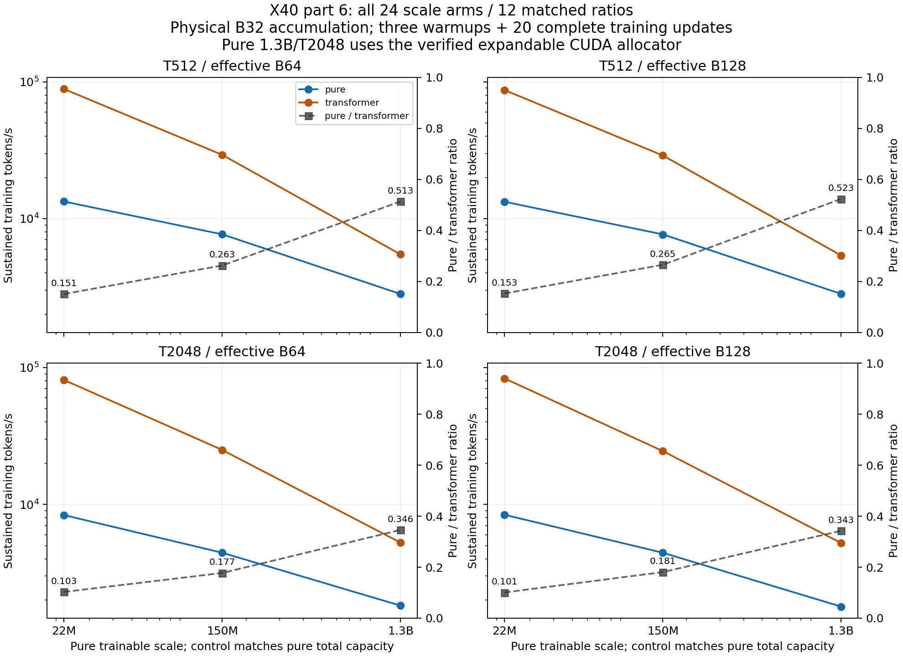

# X40 part 7 — OOM fixes, complete surface, fresh gate measurement

100k acceptance gate: **FAILED**. Sustained surface arms: 24/24; matched ratios: 12/12.

A rate requires three warmups and 20 synchronized forward, backward, gradient clipping and AdamW updates. Failures retain their errors and memory peaks, with no invented rate. The surface is a capacity-matched compute experiment, not a model-quality comparison. Scales name pure trainable counts; controls match pure total capacity, including frozen features, within 0.1%. This is not matched trainable capacity.

| Scale | T | Effective B | Pure tok/s | Transformer tok/s | Ratio | Pure peak GiB | Control peak GiB |
|---|---:|---:|---:|---:|---:|---:|---:|
| 22M | 512 | 64 | 13,343.8 | 88,592.5 | 0.1506 | 1.538 | 3.013 |
| 22M | 512 | 128 | 13,285.9 | 87,094.4 | 0.1525 | 1.540 | 3.013 |
| 22M | 2048 | 64 | 8,356.6 | 81,221.8 | 0.1029 | 5.957 | 8.615 |
| 22M | 2048 | 128 | 8,402.8 | 83,347.4 | 0.1008 | 5.958 | 8.615 |
| 150M | 512 | 64 | 7,677.3 | 29,234.0 | 0.2626 | 4.483 | 5.758 |
| 150M | 512 | 128 | 7,671.8 | 28,927.5 | 0.2652 | 4.481 | 5.758 |
| 150M | 2048 | 64 | 4,432.0 | 24,982.1 | 0.1774 | 10.363 | 11.294 |
| 150M | 2048 | 128 | 4,433.0 | 24,523.8 | 0.1808 | 10.362 | 11.294 |
| 1.3B | 512 | 64 | 2,812.8 | 5,478.0 | 0.5135 | 27.043 | 28.943 |
| 1.3B | 512 | 128 | 2,819.4 | 5,386.8 | 0.5234 | 27.042 | 28.944 |
| 1.3B | 2048 | 64 | 1,820.2 | 5,257.6 | 0.3462 | 41.100 | 42.753 |
| 1.3B | 2048 | 128 | 1,791.4 | 5,226.3 | 0.3428 | 41.101 | 42.754 |

Receipt validation: passed; 58 two-update controls (45 pass / 13 actual OOM), 358 native fixture executions and 15 local tests. See receipts/part6/part7_validation.json for independently recomputed rates, immutable core-source bindings, token/replay checks and explicit failed controls.

## Memory fixes and attribution

Recorded reentrant checkpointing forces the certified recording path in both passes, returns the auxiliary gate through checkpoint, and clears Cell.gate_mean so it cannot retain prior replay graphs. Physical B32 accumulation weights each microbatch by its token fraction, then clips and updates once per effective batch. Completed-journal packing clones only the measured maximum used prefix while retaining writer overflow assertions and the transient full writer reservation. Its host maximum synchronization is included in timing. Bounded fp32 projection is used for both architectures; this differs from part5 dense bf16 projection.

Before/after and isolated controls below are observed peak allocated GiB. Control status is explicit: OOM peak is a partial-run high water, not the memory required to finish. Controls use two updates to include initialized optimizer state; only the surface columns claim sustained throughput. Combined baseline-to-surface savings cannot be attributed to any single lever. Transformer physical/B32 controls hold reentrant checkpointing and bounded projection fixed to isolate accumulation; native journal packing is not applicable to them.

| Scale/T/B/arm | Historical rerun | Legacy bounded | Checkpoint physical | Accumulated B32 | Packed B32 | Final surface |
|---|---|---|---|---|---|---|
| 1.3B/2048/128/pure | failed / 42.608 | failed / 43.890 | failed / 46.273 | passed / 42.729 | passed / 41.100 | passed / 41.101 |
| 1.3B/512/128/pure | failed / 45.452 | failed / 45.454 | passed / 38.323 | passed / 27.349 | passed / 26.941 | passed / 27.042 |
| 1.3B/2048/64/pure | failed / 43.776 | failed / 46.600 | failed / 46.311 | passed / 42.728 | passed / 41.099 | passed / 41.100 |
| 1.3B/512/64/pure | failed / 45.759 | failed / 45.699 | passed / 27.573 | passed / 27.349 | passed / 26.940 | passed / 27.043 |
| 1.3B/2048/128/transformer | failed / 41.102 | not isolated | failed / 45.315 | passed / 42.748 | not applicable | passed / 42.754 |
| 1.3B/512/128/transformer | failed / 41.028 | not isolated | passed / 37.399 | passed / 28.943 | not applicable | passed / 28.944 |
| 1.3B/2048/64/transformer | failed / 42.779 | not isolated | failed / 46.330 | passed / 42.747 | not applicable | passed / 42.753 |
| 150M/2048/128/pure | failed / 45.365 | failed / 42.421 | passed / 37.685 | passed / 11.511 | passed / 10.351 | passed / 10.362 |
| 150M/512/128/pure | failed / 42.795 | failed / 46.494 | passed / 10.815 | passed / 4.876 | passed / 4.468 | passed / 4.481 |
| 150M/2048/64/pure | failed / 45.980 | failed / 45.009 | passed / 19.924 | passed / 11.510 | passed / 10.350 | passed / 10.363 |
| 150M/512/64/pure | failed / 37.311 | passed / 37.723 | passed / 6.552 | passed / 4.876 | passed / 4.467 | passed / 4.483 |
| 150M/2048/128/transformer | failed / 28.265 | not isolated | passed / 32.508 | passed / 11.269 | not applicable | passed / 11.294 |
| 150M/2048/64/transformer | failed / 30.451 | not isolated | passed / 17.787 | passed / 11.268 | not applicable | passed / 11.294 |
| 22M/2048/128/pure | failed / 46.093 | failed / 46.105 | passed / 26.754 | passed / 7.103 | passed / 5.941 | passed / 5.958 |
| 22M/512/128/pure | failed / 46.217 | passed / 34.356 | passed / 5.600 | passed / 1.813 | passed / 1.521 | passed / 1.540 |
| 22M/2048/64/pure | failed / 42.007 | failed / 46.705 | passed / 13.618 | passed / 7.102 | passed / 5.940 | passed / 5.957 |
| 22M/2048/128/transformer | failed / 19.921 | not isolated | passed / 30.492 | passed / 8.605 | not applicable | passed / 8.615 |
| 22M/2048/64/transformer | failed / 41.348 | not isolated | passed / 15.741 | passed / 8.604 | not applicable | passed / 8.615 |

The first 22 completed arms used the installed allocator without verified expandable segments; only the final two 1.3B/T2048 pure arms use the verified expandable allocator, with GPU checkpoint inputs. This backend difference is retained in the ratios; the transformer arms retain their earlier allocator setting. All new isolated memory controls use the verified allocator. PYTORCH_ALLOC_CONF alone did not activate expandable segments; the legacy PYTORCH_CUDA_ALLOC_CONF alias was also required and verified in allocator_settings. Earlier OOMs and the interrupted CPU-input-offload diagnostic remain archived; offload has exactness gates but no accepted sustained rate.

Native stores retain horizons 128/512/2048/8192 and heterogeneous budgets 64/256/736/1472. Measured journal retention, not a native-store floor, motivated checkpointing and packing. If future scale snapshots show native payload dominance after these fixes, a scale-only proposed quarter budget 16/64/184/368 would reduce payload by 75%. It is unvalidated and unapplied: require explicit architecture approval, production parity against that declared policy, and new matched quality curves before accepting a changed model. No pilot-family budget changes.

## Fresh 100k gate

Best sustained pure receipt: **55,618.8 tok/s**, pilot_B128_fusion_on_clear_registers0_chunk1024, B128/T512. Mean update 1.178307 s; 100k budget 0.655360 s; additional required saving 0.522947 s (1.798x).

The best point's separate profile measures 593.944 ms replay and 246.605 ms core backward (70.66% replay of backward device busy time). These are separate-profile busy times, not an additive wall identity, an achieved saving, or an irreducible floor.

| Fresh pilot | B | Raw sustained tok/s | Matched curve | Qualification |
|---|---:|---:|---|---|
| pilot_B128_fusion_off_clear_registers0_chunk1024 | 128 | 54,810.7 | passed | qualified |
| pilot_B128_fusion_on_clear_registers0_chunk1024 | 128 | 55,618.8 | passed | qualified |
| pilot_B128_part7_registers0_chunk1024 | 128 | 55,607.5 | passed | qualified |

Pool fusion removes 216 kernels and 240 inclusive device activities per full update. Mean inclusive activities per replay: 21.00 -> 11.00; sustained speedup 1.015x. This is partial launch fusion; it does not establish complete inclusive replay closure or a hardware floor.

Integer pool fusion comparison: **passed**. See fusion_comparison.json for inclusive correlated device activity counts; separate profiles are excluded from wall timing. Unaccepted register, stream and deferred-packing candidates are retained as experimental sources, with no performance claim.

## Validation and residual risks

Production parity: `{"2048": "passed", "2048_expandable": "passed", "512": "passed", "512_expandable": "passed"}`.

Strict checkpoint byte gates: `{"checkpoint_gate_B1_T2048_packed.json": "passed", "checkpoint_gate_B1_T2048_packed_fp32.json": "passed", "checkpoint_gate_B1_T512_packed.json": "passed", "checkpoint_gate_B1_T512_packed_fp32.json": "passed", "checkpoint_gate_B32_T2048_packed_expandable.json": "passed", "checkpoint_gate_B32_T2048_packed_fp32_expandable.json": "passed", "checkpoint_gate_B32_T512_packed_expandable.json": "passed", "checkpoint_gate_B32_T512_packed_fp32_expandable.json": "passed"}`.

Native fixtures: `{"x31_tape_cell_fused": {"errors": 0, "failures": 0, "skipped": 0, "status": "passed", "tests": 109}, "x36_tape_perf": {"errors": 0, "failures": 0, "skipped": 0, "status": "passed", "tests": 70}}`.

Local regressions: `{"passed": 15, "status": "passed"}`.

Accumulated pilot-v1 curve: `{"max_loss_difference": 1.430511474609375e-06, "status": "passed", "steps": 64, "tokens": 2097152, "tolerance": 1e-05}`.

The token-equivalence receipt proves disjoint microbatch coverage, weighted means, native replay counts and one optimizer update per effective batch. It does not claim bitwise dense-gradient equality between physical and accumulated batches. Separate pilot curves retain the 1e-5 loss contract.

Residual risks: 100k gate status is failed; no irreducible hardware floor is established. B1/B32 checkpoint gates do not prove every width/shape bytewise; the scale quality curve is not measured. Synthetic data are not identical token tensors across architectures. Some controls can still OOM. Packing retains transient reservations and host waits; allocator and pinned-input behavior are backend dependent. Production defaults retain their existing path; candidates are scoped probe helpers, not automatically promoted defaults.

Evidence: receipts/part6/summary.json, memory_breakdown.json, token_equivalence.json, part7_commands.log, all raw surface/log receipts and archived failures. Tool discovery found no contact_supervisor. GPU work is sequential via run_leased.sh on physical 1/5/6; protected PID 634691 and cards 0/2/3/4/7 are untouched. No .pt artifacts, WG, subagents, Frontier, Slurm or resilient DiLoCo changes. AGENTS.md and CLAUDE.md are unchanged.
