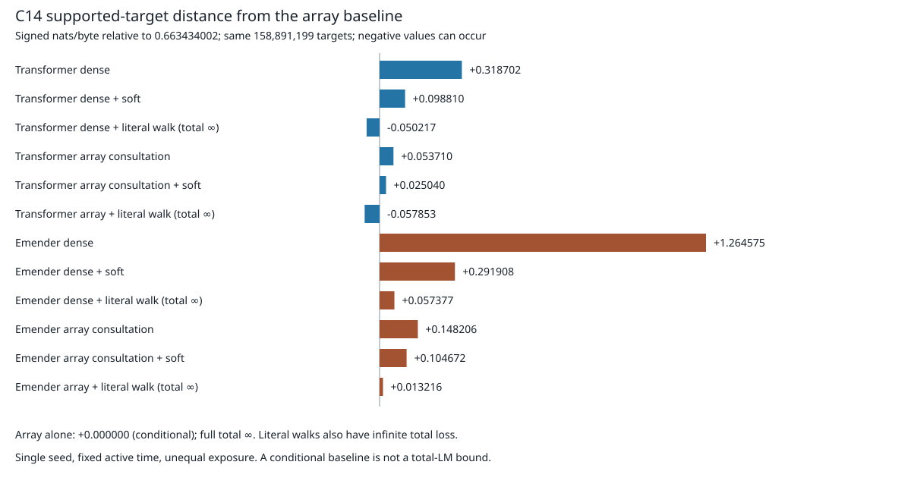

# C14: the complete first-pass four-family table

Frozen final-test: 214,097,022 real byte targets; 158,891,199 supported targets. NLL is nats/byte. All frozen arms are unchanged. Literal-walk rows are failed total-LM recipes, retained as measured rungs. Each soft row uses its own calibration-only C13 logistic gate, fitted on nonempty forks and applied to all nonempty support without forced walks. Empty support abstains to the head. No final-test fitting, checkpoint changes, new extraction or dropped targets.

| Family / rung | Total | Supported | Supported − array | Zero target | Reset 1–16 | Interior 17–128 | Fork |
| --- | ---: | ---: | ---: | ---: | ---: | ---: | ---: |
| Transformer dense | 1.404428829 | 0.982135756 | +0.318701754 | 2.619855916 | 1.711343480 | 1.360079113 | 1.810892120 |
| Transformer dense + soft | 1.299507807 | 0.762243731 | +0.098809728 | 2.845839855 | 1.634588207 | 1.251088091 | 1.747920206 |
| Transformer dense + literal walk (total ∞) | ∞ | 0.613216841 | -0.050217161 | ∞ | ∞ | ∞ | 1.747920206 |
| Transformer array consultation | 1.266063829 | 0.717143862 | +0.053709860 | 2.845943395 | 1.622003794 | 1.214629869 | 1.736909749 |
| Transformer array consultation + soft | 1.263566972 | 0.688473811 | +0.025039809 | 2.918777181 | 1.610444437 | 1.213442558 | 1.728974703 |
| Transformer array + literal walk (total ∞) | ∞ | 0.605580716 | -0.057853286 | ∞ | ∞ | ∞ | 1.728974703 |
| Emender dense | 2.276133551 | 1.928009239 | +1.264575237 | 3.278091066 | 2.288503431 | 2.274346081 | 2.526644206 |
| Emender dense + soft | 1.695958394 | 0.955341644 | +0.291907641 | 3.827572000 | 1.841368583 | 1.674946362 | 2.167601364 |
| Emender dense + literal walk (total ∞) | ∞ | 0.720811102 | +0.057377100 | ∞ | ∞ | ∞ | 2.167601364 |
| Emender array consultation | 1.509260010 | 0.811639725 | +0.148205723 | 3.517122903 | 1.748787269 | 1.474647893 | 2.010901269 |
| Emender array consultation + soft | 1.505908651 | 0.768105627 | +0.104671625 | 3.629423900 | 1.723841133 | 1.474417018 | 1.997437883 |
| Emender array + literal walk (total ∞) | ∞ | 0.676649869 | +0.013215867 | ∞ | ∞ | ∞ | 1.997437883 |
| Array alone (conditional oracle) | ∞ | 0.663434002 | +0.000000000 | ∞ | ∞ | ∞ | ∞ |

The array-alone row is the unsmoothed maximal-supported-suffix empirical distribution. “Oracle” is conditional shorthand: selecting targets with q(target)>0 is answer-conditioned. It is neither a fair total-LM baseline nor a mathematical lower bound for a trained head. Total loss is infinite on zero-target positions, including empty support. Distances above use only the identical supported-target denominator.

## Transformer P3: all signs

| Stratum | Targets | Consulted | Consulted + soft | Soft − consulted | Dense + soft | Consulted soft − dense soft |
| --- | ---: | ---: | ---: | ---: | ---: | ---: |
| total | 214,097,022 | 1.266063829 | 1.263566972 | -0.002496858 | 1.299507807 | -0.035940836 |
| window_reset_1_16 | 27,031,327 | 1.622003794 | 1.610444437 | -0.011559357 | 1.634588207 | -0.024143771 |
| window_interior_17_128 | 187,065,695 | 1.214629869 | 1.213442558 | -0.001187310 | 1.251088091 | -0.037645533 |
| wikipedia_support | 213,177,555 | 1.261806339 | 1.259298712 | -0.002507627 | 1.295884610 | -0.036585898 |
| empty_support | 919,467 | 2.253158814 | 2.253158814 | +0.000000000 | 2.139542621 | +0.113616194 |
| supported_target | 158,891,199 | 0.717143862 | 0.688473811 | -0.028670052 | 0.762243731 | -0.073769920 |
| nonempty_zero_target | 54,286,356 | 2.855983595 | 2.930050992 | +0.074067397 | 2.857802659 | +0.072248334 |
| zero_target | 55,205,823 | 2.845943395 | 2.918777181 | +0.072833786 | 2.845839855 | +0.072937326 |
| fork | 98,425,906 | 1.736909749 | 1.728974703 | -0.007935046 | 1.747920206 | -0.018945503 |
| nonfork | 115,671,116 | 0.865415527 | 0.867546087 | +0.002130560 | 0.917948451 | -0.050402364 |
| forced | 114,751,649 | 0.854295999 | 0.856443631 | +0.002147632 | 0.908160221 | -0.051716590 |
| forced_zero_target | 30,751,940 | 2.691986465 | 2.767543630 | +0.075557165 | 2.618820854 | +0.148722776 |

Soft P3 **PASS**: beats consulted alone **True**; beats dense+calibration **True**. Total change is **-0.002496858** (-0.1972%). Reset positions contribute **58.452%** of the net gain (signed ratio, not a causal attribution).

Fusion changes the transformer’s total by -0.002496858; the residual gain is +0.002496858, versus the dense transformer’s fusion gain +0.104921021. The residual is 2.380% of the dense-fusion gain (a descriptive ratio, not an identified causal effect).

The Emender comparison was 1.509260010 → 1.505908651 (−0.003351359; 93.981% of net gain at reset). The small post-consultation fusion residual replicates on the better reader: transformer −0.002496858 versus Emender −0.003351359. Its reset concentration differs (58.452% versus 93.981%); the transformer also gains in the interior. Both soft stacks worsen zero-target and nonfork losses. This is consistent with consultation already capturing most of this gate recipe’s benefit, but does not prove absorption into weights.

Literal C13 forced walks remain **FAIL** for both transformer dense and consulted arms: total ∞, 30,751,940 forced-zero final targets. Supported consulted+walk NLL is 0.605580716; this conditional finite score cannot rescue the total. Emender exact-walk total also fails on the same 30,751,940 targets. No smoothing or target-conditioned escape.

## Measured head verdict and its limits

The tier-1 C13 asymmetry inverts at Pile scale. The transformer is the better array-reader at this registered budget: consulted total 1.266063829 vs 1.509260010, supported 0.717143862 vs 0.811639725. Its supported distance from the array is +0.053709860 vs +0.148205723. The larger Emender gain over dense does not reverse this absolute ranking. Transformer P1 PASS, P2 FAIL; both consulted heads worsen zero-target loss. The retained Emender claims are operator causality, unbounded-store data-efficiency and bounded-state theory, each under its own receipt scope.

This is a first-pass single-seed, equal-active-time comparison with unequal training exposure. No uncertainty estimate, matched-target architecture effect, semantic mechanism or universal head ranking is established. Tiny BF16 replay differences from historical dense batch-16 losses remain separate: current transformer paired batch-128 total is 1.404428829 vs historical 1.404434206. The main table uses current paired/stacking replays; Emender raw/stacked rows use its prior retained stacking receipts.

Evidence: [transformer verdict](RESULT_C14_TRANSFORMER.md), [Emender stacking](RESULT_C14_STACKING.md), transformer [gates](receipts/c14_transformer_stacking/frozen_gates.json), [freeze](receipts/c14_transformer_stacking/calibration_freeze.json), [full calibration and final table](receipts/c14_transformer_stacking/table.json), [independent replay](receipts/c14_transformer_stacking/validation.json). Calibration has 220,107,062 targets, with 101,006,646 nonempty fork fitting targets; document split, windows, checkpoint, prediction and code hashes are retained.

No resilient DiLoCo behavior was changed or run; requirement IDs from RESILIENT_DILOCO_GAP_MATRIX.md are inapplicable. No Frontier/Slurm, WorksGood, subagents, new training, frozen-arm edits, or .pt commits. Only broker cards 2/4 are eligible; card 1, ~/sxgc and /mnt/nvme2n1 remain unchanged.

---

**Dated annotation (2026-11-10) — in-region source leakage.** Every consulted and
array-alone number in this file is optimistically biased: the branch query did not
exclude the evaluated position's own occurrence from the index's counts, and the index
was built over the same corpus the evaluated documents come from. See
[RESULT_C14_IN_INDEX_LEAKAGE.md](RESULT_C14_IN_INDEX_LEAKAGE.md). The numbers stand as
measured; they are not held-out clean. The transfer conclusion (out-of-index gains
exceed in-region gains) is unaffected and is now better explained. The flagship and
150 M boards are leakage-free by span geometry (spine `[0,100GB)`, all train and eval
documents beyond it).
